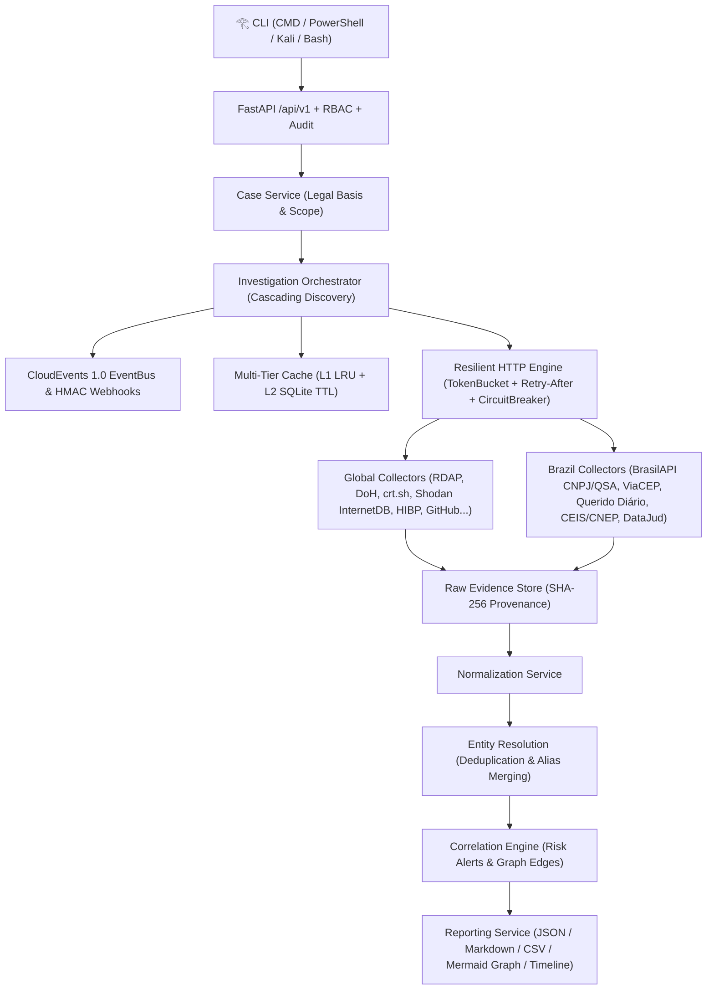

# 𓂀 God's Eye (Eye of Horus) — OSINT Aggregation, Correlation & Threat Intelligence Platform

<div align="center">

```text
               _.o888888888888888888888888888o._
          _.o888888888888888888888888888888888888o._
       .o888P"   ____...---=======---...____   "Y888o.
     .888P"  _.-"                           "-._  "Y888.
    d88P   .-"       _..---=======---.._       "-.   Y88b
   ""    ."      _.-"    .d8888888b.    "-._      ".    ""
        /     .-"       d8888(𓂀)8888b       "-.     \
       (=====(          8888888888888          )=====)
        \     "-._      Y88888888888P      _.-"     /
         ".       "-._   "Y8888888P"   _.-"       ."
           "-._       "---...___...---"       _.-"
               "---...____   |||   ____...---"
                          |  |||  \
                          |  |||   \      _.._
                          |  |||    \   ."    ".
                          |  |||     \  |  ()  |
                         d8b |||      "._".__."
                        d888b|||
                         "Y8P"|
```

**All-Seeing Open Source Intelligence (OSINT) Hub for Cybersecurity Analysts**  
*Windows CMD • Windows PowerShell • Linux • Kali Linux • FastAPI v1 REST Backend*

[](#)
[](#)
[](#)
[](#)
[](#)

[**English Documentation**](#-english-documentation) • [**Documentação em Português (BR)**](#-documentação-em-português-brasil)

</div>

---

# 🌐 English Documentation

## 1. Overview

**God's Eye (`𓂀`)** is an enterprise-grade, event-driven Open Source Intelligence (OSINT) aggregation, correlation, and threat intelligence platform designed for defensive cybersecurity analysts, SOC teams, threat hunters, and incident responders.

Unlike monolithic scrapers, **God's Eye** operates as a **provenance-first aggregation and correlation hub**:
- **135+ Curated OSINT Sources + Dynamic OSINT Brazuca Importer**: 100 Global OSINT APIs ([`100-apis-osint-gratuitas.md`](100-apis-osint-gratuitas.md)) + 18 specialized Brazilian public/official sources ([`apis-osint-brasil.md`](apis-osint-brasil.md)) + Phase 2 expansion sources ([`expansao-osint-modulos-fontes-apis.md`](expansao-osint-modulos-fontes-apis.md)) including **OSINT Brazuca** dynamic candidate catalog governance.
- **First-Class Multi-Domain OSINT Collectors**:
  - **Phone OSINT**: ITU-T E.164 normalization, Brazilian DDD/UF regional lookup (`BrasilAPI DDD`), and ANATEL telecom carrier/line-type metadata.
  - **Crypto OSINT**: Multi-chain wallet, transaction, and cluster intelligence (`Bitcoin`, `Ethereum`, `TRON`, `Solana`) with OFAC SDN / OpenSanctions compliance screening.
  - **Dark Web, Pastes & Infostealer Exposure Metadata**: Queries Hudson Rock Cavalier API for corporate/email infostealer metadata strictly without storing raw dumps or passwords.
  - **Media & Image EXIF Verification**: SHA-256 cryptographic hashing and header inspection for image/document evidence.
- **Watchlists & Continuous Monitoring Alerts**: Subscribe to 13 granular OSINT event types (`breach.detected`, `sanction.detected`, `crypto.address_flagged`, `domain.subdomain_discovered`, `official_gazette.mention_detected`, etc.) with real-time alert generation and analyst acknowledgment.
- **Investigative Collaboration & 4-Eyes Verification**: Analyst comments with `@mentions`, assigned investigative tasks, human verification records (`corroborated`, `contested`, `false_positive`), and immutable SHA-256 versioned dossier snapshots.
- **Data Quality Scoring & Conflict Governance**: Multi-factor confidence formula (`source_trust + recency + corroboration + official_bonus - conflict_penalty - stale_penalty`) and automatic detection of inter-source attribute contradictions (`DataConflict`).
- **Auditable Assistive AI**: Generates executive summaries and conflict explanations explicitly marked `confidence_kind="model_generated"` and `human_review_status="pending_review"` requiring human analyst approval.
- **Cascading Multi-Hop Discovery**: Automatically pivots across related entities (e.g., `Email` → `Domain` & `Username` → `RDAP / DNS DoH / Certificate Transparency (crt.sh) / Wayback / urlscan.io` → `Resolved IP` → `Shodan InternetDB Ports & CVEs / GeoIP / RIPEstat BGP`).
- **Evidence-First & SHA-256 Provenance**: Every raw finding is sanitized, hashed (`SHA-256`), timestamped, versioned, and stored before entity normalization or graph correlation.
- **Resilient Rate-Limit & Backoff Engine**: Per-source proactive `TokenBucket` throttling, `Retry-After` (seconds & HTTP-date) and `x-ratelimit-reset` header parsing, full-jitter exponential backoff, and per-source `CircuitBreaker`.
- **Multi-Tier Cache**: L1 in-memory LRU cache + L2 SQLite WAL TTL cache with deterministic idempotency keys (`case_id + target + source + adapter_version`).
- **Privacy, RBAC & Compliance (LGPD / GDPR)**: Role-Based Access Control (`admin`, `investigator`, `analyst`, `auditor`), mandatory legal basis per case, automatic redaction of plaintext passwords/credential dumps, and SHA-256 masking of sensitive identifiers (CPF, vehicle plates).

---

## 2. Architecture



---

## 3. Zero-Config Installation Guide (English) — Ready to Use Out of the Box

**God's Eye (`𓂀`) is 100% Zero-Config.** You do **not** need to manually create virtual environments, install packages, configure databases, or buy API keys. The launchers (`godseye.bat`, `godseye.ps1`, `godseye.sh`) and one-click installers (`install.bat`, `install.ps1`, `install.sh`) automatically bootstrap `.venv`, install dependencies, generate `.env`, initialize the SQLite WAL database (`~/.godseye/godseye.db`), and load all **140 OSINT sources** on first run!

### 3.1 Windows (CMD & PowerShell) — 1-Command Zero-Config

```cmd
git clone https://github.com/ViniciusCostaGrillo/gods-eye.git
cd gods-eye

REM Option 1: Run immediately (auto-creates .venv & installs dependencies on first run!)
godseye.bat

REM Option 2: Register 'godseye' globally in Windows User PATH so it works from any folder:
install.bat
godseye doctor
godseye scan example.com
```

In **Windows PowerShell**:
```powershell
.\godseye.ps1
# Or install globally into User PATH:
.\install.ps1
godseye scan 00.000.000/0001-91 --output dossier.md --format md
```

---

### 3.2 Linux (Ubuntu, Debian, Fedora, Arch) — 1-Command Zero-Config

```bash
git clone https://github.com/ViniciusCostaGrillo/gods-eye.git
cd gods-eye
chmod +x install.sh godseye.sh
./install.sh

# Now run from any terminal directory:
godseye
godseye scan example.com
```

---

### 3.3 🐉 Kali Linux (Penetration Testing & OSINT Workstation) — 1-Command Zero-Config

On **Kali Linux**, `./install.sh` automatically handles **PEP 668** (`externally-managed-environment`) by creating an isolated `.venv`, installing `fonts-noto-core` (for the Egyptian Eye of Horus glyph `𓂀`), and linking `/usr/local/bin/godseye`:

```bash
git clone https://github.com/ViniciusCostaGrillo/gods-eye.git
cd gods-eye
chmod +x install.sh godseye.sh
./install.sh

# Ready! Launch interactive menu or scan targets from anywhere in Kali Linux:
godseye
godseye menu
godseye doctor
godseye scan +5511999998888
```

---

## 4. CLI Commands & FastAPI Server Reference

| Command | Description | Example |
|---|---|---|
| `godseye` / `godseye banner` | Render the **Eye of Horus (`𓂀`)** emblem and command overview | `godseye` |
| `godseye scan <target>` | Run cascading OSINT collection (Email, Domain, IP, CNPJ, CEP, Username, Phone, Crypto, Image) | `godseye scan +5511999998888` |
| `godseye watchlist` | Create or list continuous monitoring watchlists & alert rules | `godseye watchlist --create example.com` |
| `godseye alerts` | View and acknowledge triggered continuous monitoring alerts | `godseye alerts --unack` |
| `godseye brazuca` | Import & approve candidate Brazilian sources from OSINT Brazuca | `godseye brazuca --import` |
| `godseye quality <case_id>` | Compute multi-factor Data Quality Scores & inter-source conflicts | `godseye quality <case_id>` |
| `godseye ai-assist <case_id>` | Generate or review auditable Assistive AI analysis (`model_generated`) | `godseye ai-assist <case_id>` |
| `godseye collaborate <case_id>` | Add `@mention` comments, tasks, 4-eyes verifications & snapshots | `godseye collaborate <case_id> -m "Check @alice"` |
| `godseye sources` | List the 135+ cataloged Global & Brazilian OSINT APIs | `godseye sources --region brasil` |
| `godseye cases` | List all investigative cases and LGPD/GDPR legal bases | `godseye cases` |
| `godseye graph <case_id>` | Render ASCII relationship graph or `--mermaid` diagram | `godseye graph <case_id> --mermaid` |
| `godseye timeline <case_id>` | Display chronological collection & correlation timeline | `godseye timeline <case_id>` |
| `godseye report <case_id>` | Export auditable OSINT dossier (`json`, `md`, `csv`) | `godseye report <case_id> -f md -o out.md` |
| `godseye audit` | Inspect immutable RBAC and compliance audit logs | `godseye audit` |
| `godseye benchmark` | Run L1/L2 cache & rate-limit resilience benchmark | `godseye benchmark` |
| `godseye shell` | Start interactive analyst REPL (`𓂀 godseye>`) | `godseye shell` |
| `godseye serve` | Launch FastAPI `/api/v1` server (`http://127.0.0.1:8000/docs`) | `godseye serve --port 8000` |

---
---

# 🇧🇷 Documentação em Português (Brasil)

## 1. Visão Geral

O **God's Eye (`𓂀` — Olho de Hórus)** é uma plataforma e ferramenta CLI de **OSINT (*Open Source Intelligence*)**, agregação de fontes abertas, resolução de entidades e correlação investigativa voltada para analistas de cibersegurança, equipes de SOC, CTI (*Cyber Threat Intelligence*), resposta a incidentes e compliance.

Construído a partir das especificações de [`documentacao-backend-agregador-osint.md`](documentacao-backend-agregador-osint.md), [`100-apis-osint-gratuitas.md`](100-apis-osint-gratuitas.md), [`apis-osint-brasil.md`](apis-osint-brasil.md) e [`expansao-osint-modulos-fontes-apis.md`](expansao-osint-modulos-fontes-apis.md), o **God's Eye** segue os princípios:
- **135+ Fontes OSINT Catalogadas + Importador Dinâmico OSINT Brazuca**: 100 APIs Globais + 18 fontes oficiais e abertas do Brasil + módulos de expansão da Fase 2 com importação governada de fontes candidatas (`SourceReviewStatus.CANDIDATE` → aprovação humana obrigatória).
- **Novos Coletores de Primeira Classe (Fase 2)**:
  - **Phone OSINT (`phone_osint`)**: Normalização E.164, consulta de DDD/UF e municípios via `BrasilAPI DDD`, tipo de linha (`mobile`/`landline`) e metadados regulatórios da ANATEL.
  - **Crypto OSINT (`crypto_osint`)**: Detecção automática de rede (`Bitcoin`, `Ethereum`, `TRON`, `Solana`), saldo/transações on-chain e triagem de risco contra listas de sanções (`OFAC SDN / OpenSanctions`).
  - **Dark Web, Pastes & Infostealers (`hudsonrock`)**: Consulta pública à API Cavalier da Hudson Rock retornando exclusivamente metadados de exposição por infostealers (sem jamais armazenar senhas ou *dumps* brutos).
  - **Verificação de Mídia e EXIF (`image_exif`)**: Hash criptográfico SHA-256 e inspeção de cabeçalhos de arquivos de imagem/evidência.
- **Watchlists e Alertas Contínuos**: Monitoramento contínuo de 13 tipos de eventos (`breach.detected`, `sanction.detected`, `crypto.address_flagged`, `domain.subdomain_discovered`, `official_gazette.mention_detected`, etc.) com geração de alertas e reconhecimento (`acknowledge`) auditado.
- **Colaboração Investigativa, Qualidade de Dados e IA Assistiva Auditável**:
  - Comentários com `@menções`, tarefas investigativas (`InvestigativeTask`), verificação humana em 4 olhos (`corroborated`, `contested`, `false_positive`) e versionamento imutável de dossiês (`CaseVersion`).
  - Cálculo de `DataQualityScore` multi-fator e detecção automática de conflitos entre fontes (`DataConflict`).
  - Camada de IA Assistiva (`AssistiveAIService`) com marcação estrita `confidence_kind="model_generated"` e revisão humana obrigatória (`pending_review` → `approved` / `rejected`).
- **Descoberta em Cascata (*Multi-Hop*)**:
  - Ao investigar um **E-mail** (`usuario@empresa.com`), extrai automaticamente o **Domínio** e o **Username**, consulta `RDAP`, `DNS-over-HTTPS`, `crt.sh (Certificados TLS e Subdomínios)`, `urlscan.io`, `Wayback Machine`, `HIBP`, `GitHub` e `Keybase`, e pivota para os **IPs resolvidos** consultando portas e CVEs no `Shodan InternetDB`, geolocalização no `ip-api` e roteamento BGP no `RIPEstat`.
  - Ao investigar um **CNPJ** (`00.000.000/0001-91`), consulta dados societários e **QSA (Quadro de Sócios e Administradores)** na Receita Federal/BrasilAPI, menções em **Diários Oficiais** (`Querido Diário`), sanções administrativas no **Portal da Transparência (`CEIS/CNEP`)**, metadados processuais no **DataJud/CNJ** e pivota automaticamente para o **CEP** da sede.
- **Evidência Primeiro & Proveniência SHA-256**: Cada resposta bruta gera um registro imutável de `RawEvidence` com hash criptográfico `SHA-256`, URL de origem, versão do adaptador e timestamp UTC antes de qualquer inferência.
- **Resiliência de API (`TokenBucket` + `Retry-After` + `CircuitBreaker`)**: Controle de taxa proativo por fonte, leitura dos cabeçalhos `Retry-After` (segundos ou data HTTP) e `x-ratelimit-reset`, backoff exponencial com *full jitter* e disjuntor (*Circuit Breaker*) automático.
- **Conformidade LGPD & Segurança por Padrão**: Controle de acesso baseado em papéis (`RBAC`: `admin`, `investigator`, `analyst`, `auditor`), base legal obrigatória por caso, bloqueio e redação automática de senhas em texto claro ou *dumps* brutos, mascaramento de CPFs (`***.456.789-**`) e placas veiculares, além de trilha de auditoria imutável (`AuditEvent`).

---

## 2. Guia de Instalação Zero-Config (Português) — Pronto para Uso sem Configurar Nada

O **God's Eye (`𓂀`)** foi projetado para ser **100% Zero-Config (*Turnkey*)**. Você **não precisa** criar ambientes virtuais manualmente, instalar pacotes um a um, criar banco de dados ou configurar chaves de API pagas:
- Ao rodar `godseye.bat`, `.\godseye.ps1` ou `./godseye.sh` pela primeira vez, ele **cria o `.venv` e instala todas as dependências automaticamente**, gera o `.env` padrão, inicializa o banco SQLite WAL (`~/.godseye/godseye.db`), carrega as **140 fontes OSINT** (incluindo o catálogo **OSINT Brazuca**) e abre o **Menu Interativo Numerado (`[1]` a `[6]`)** onde basta colar o alvo para investigar!
- Se rodar o instalador de 1 clique (`install.bat` / `install.ps1` no Windows ou `./install.sh` no Linux/Kali), o comando `godseye` também é adicionado automaticamente ao `PATH` do seu sistema para funcionar de qualquer pasta!

### 2.1 Windows (CMD e PowerShell) — Pronto em 1 Comando

```cmd
git clone https://github.com/ViniciusCostaGrillo/gods-eye.git
cd gods-eye

REM Opcao 1: Executar direto (configura tudo sozinho no primeiro uso e abre o Menu Interativo!)
godseye.bat

REM Opcao 2: Instalar no PATH do Windows para usar o comando 'godseye' de qualquer pasta:
install.bat
godseye doctor
godseye scan 00.000.000/0001-91
```

No **Windows PowerShell**:
```powershell
.\godseye.ps1
# Ou instalar no PATH do usuário com 1 clique:
.\install.ps1
godseye menu
```

---

### 2.2 Linux (Ubuntu, Debian, Fedora, Arch) — Pronto em 1 Comando

```bash
git clone https://github.com/ViniciusCostaGrillo/gods-eye.git
cd gods-eye
chmod +x install.sh godseye.sh
./install.sh

# Pronto! Digite 'godseye' de qualquer diretório:
godseye
godseye scan example.com
```

---

### 2.3 🐉 Kali Linux (Estação de Pentest & OSINT) — Pronto em 1 Comando

No **Kali Linux**, o script `./install.sh` resolve automaticamente a restrição **PEP 668** (`externally-managed-environment`), instala o pacote de fontes de hieróglifos (`fonts-noto-core` para exibir o glifo `𓂀`), cria o ambiente `.venv` isolado e registra o comando global `/usr/local/bin/godseye`:

```bash
git clone https://github.com/ViniciusCostaGrillo/gods-eye.git
cd gods-eye
chmod +x install.sh godseye.sh
./install.sh

# Pronto para uso de qualquer pasta no Kali Linux:
godseye
godseye menu
godseye doctor
godseye scan +5511999998888
```

---

## 3. Configuração Opcional de Chaves de API (`.env`)

O **God's Eye** funciona imediatamente sem chaves (*zero-key*) usando provedores públicos abertos (`RDAP`, `Google DoH`, `crt.sh`, `Shodan InternetDB`, `ip-api`, `RIPEstat`, `Wayback Machine`, `urlscan.io`, `GitHub`, `Gravatar`, `Keybase`, `BrasilAPI CNPJ`, `ViaCEP`, `Querido Diário`, `DataJud/CNJ`). Para habilitar consultas autenticadas em provedores comerciais/governamentais, defina variáveis de ambiente ou crie um arquivo `.env`:

```env
GODSEYE_HIBP_API_KEY="sua_chave_hibp"
GODSEYE_SHODAN_API_KEY="sua_chave_shodan"
GODSEYE_VIRUSTOTAL_API_KEY="sua_chave_virustotal"
GODSEYE_URLSCAN_API_KEY="sua_chave_urlscan"
GODSEYE_ABUSEIPDB_API_KEY="sua_chave_abuseipdb"
GODSEYE_GITHUB_TOKEN="seu_token_github"
GODSEYE_PORTAL_TRANSPARENCIA_API_KEY="sua_chave_cgu_portal_transparencia"
GODSEYE_DATAJUD_API_KEY="sua_chave_cnj_datajud"
```

---

## 4. Executando os Testes e Validação de Qualidade

```bash
# Testes automatizados (Pytest + Pytest-Asyncio)
./.venv/bin/pytest -v          # Linux / Kali
.\.venv\Scripts\pytest.exe -v  # Windows

# Linter (Ruff) e Verificação Estática de Tipos (MyPy)
./.venv/bin/ruff check godseye tests
./.venv/bin/mypy godseye tests
```

---

## 5. Aviso Legal e Ético (Disclaimer)

Esta ferramenta foi desenvolvida exclusivamente para **investigações OSINT autorizadas, defesa cibernética, resposta a incidentes, *threat intelligence* e *due diligence* legal**. O operador é integralmente responsável por respeitar a legislação aplicável (**LGPD — Lei nº 13.709/2018**, **GDPR**, Marco Civil da Internet) e os Termos de Serviço de cada API consultada.
