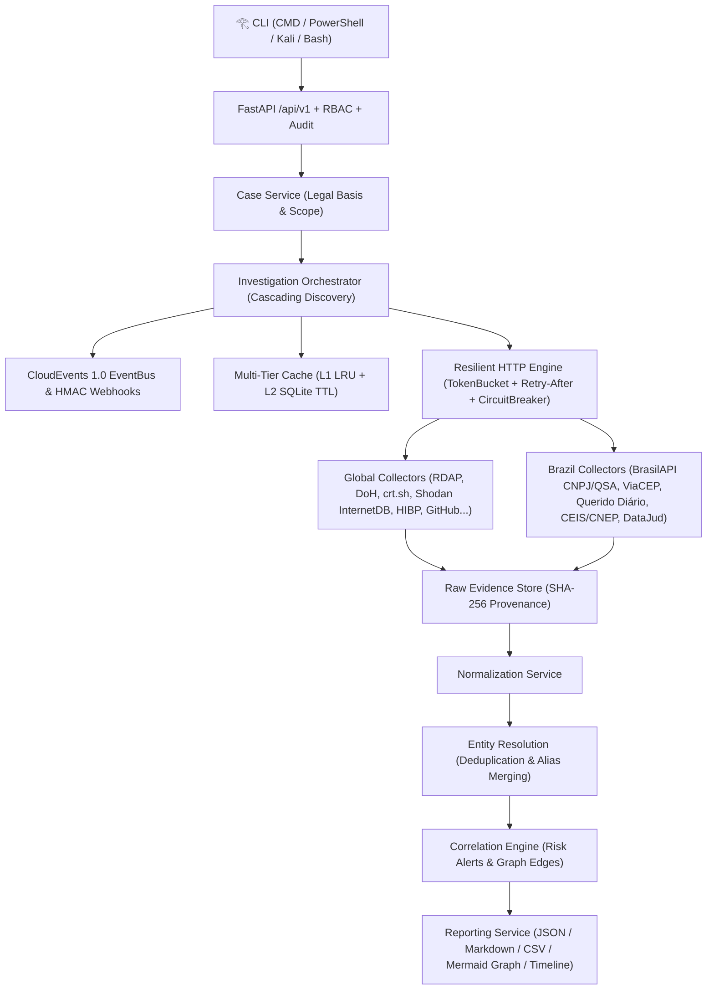

# 𓂀 God's Eye (Eye of Horus) — OSINT Aggregation, Correlation & Threat Intelligence Platform

<div align="center">

```text
               _.o888888888888888888888888888o._
          _.o888888888888888888888888888888888888o._
       .o888P"   ____...---=======---...____   "Y888o.
     .888P"  _.-"                           "-._  "Y888.
    d88P   .-"       _..---=======---.._       "-.   Y88b
   ""    ."      _.-"    .d8888888b.    "-._      ".    ""
        /     .-"       d8888(𓂀)8888b       "-.     \
       (=====(          8888888888888          )=====)
        \     "-._      Y88888888888P      _.-"     /
         ".       "-._   "Y8888888P"   _.-"       ."
           "-._       "---...___...---"       _.-"
               "---...____   |||   ____...---"
                          |  |||  \
                          |  |||   \      _.._
                          |  |||    \   ."    ".
                          |  |||     \  |  ()  |
                         d8b |||      "._".__."
                        d888b|||
                         "Y8P"|
```

**All-Seeing Open Source Intelligence (OSINT) Hub for Cybersecurity Analysts**  
*Windows CMD • Windows PowerShell • Linux • Kali Linux • FastAPI v1 REST Backend*

[](#)
[](#)
[](#)
[](#)
[](#)

[**English Documentation**](#-english-documentation) • [**Documentação em Português (BR)**](#-documentação-em-português-brasil)

</div>

---

# 🌐 English Documentation

## 1. Overview

**God's Eye (`𓂀`)** is an enterprise-grade, event-driven Open Source Intelligence (OSINT) aggregation, correlation, and threat intelligence platform designed for defensive cybersecurity analysts, SOC teams, threat hunters, and incident responders.

Unlike monolithic scrapers, **God's Eye** operates as a **provenance-first aggregation and correlation hub**:
- **118 Curated OSINT Sources**: 100 Global OSINT APIs ([`100-apis-osint-gratuitas.md`](100-apis-osint-gratuitas.md)) + 18 specialized Brazilian public/official sources ([`apis-osint-brasil.md`](apis-osint-brasil.md)).
- **Cascading Multi-Hop Discovery**: Automatically pivots across related entities (e.g., `Email` → `Domain` & `Username` → `RDAP / DNS DoH / Certificate Transparency (crt.sh) / Wayback / urlscan.io` → `Resolved IP` → `Shodan InternetDB Ports & CVEs / GeoIP / RIPEstat BGP`).
- **Evidence-First & SHA-256 Provenance**: Every raw finding is sanitized, hashed (`SHA-256`), timestamped, versioned, and stored before entity normalization or graph correlation.
- **Resilient Rate-Limit & Backoff Engine**: Per-source proactive `TokenBucket` throttling, `Retry-After` (seconds & HTTP-date) and `x-ratelimit-reset` header parsing, full-jitter exponential backoff, and per-source `CircuitBreaker`.
- **Multi-Tier Cache**: L1 in-memory LRU cache + L2 SQLite WAL TTL cache with deterministic idempotency keys (`case_id + target + source + adapter_version`).
- **Privacy, RBAC & Compliance (LGPD / GDPR)**: Role-Based Access Control (`admin`, `investigator`, `analyst`, `auditor`), mandatory legal basis per case, automatic redaction of plaintext passwords/credential dumps, and SHA-256 masking of sensitive identifiers (CPF, vehicle plates).

---

## 2. Architecture



---

## 3. Installation Guide (English)

### 3.1 Windows (CMD & PowerShell)

1. **Prerequisites**: Install [Python 3.11+](https://www.python.org/downloads/windows/) and [Git](https://git-scm.com/download/win).
2. **Clone the repository**:
   ```powershell
   git clone https://github.com/ViniciusCostaGrillo/gods-eye.git
   cd gods-eye
   ```
3. **Create the virtual environment and install dependencies**:
   ```powershell
   py -m venv .venv
   .\.venv\Scripts\python.exe -m pip install --upgrade pip
   .\.venv\Scripts\python.exe -m pip install fastapi uvicorn httpx pydantic pydantic-settings rich typer truststore pytest pytest-asyncio ruff mypy
   ```
4. **Run in Windows CMD (`cmd.exe`)**:
   > `godseye.bat` automatically configures UTF-8 (`chcp 65001`) and Windows Virtual Terminal ANSI sequences so the **Eye of Horus (`𓂀`)** renders cleanly in CMD.
   ```cmd
   godseye.bat
   godseye.bat scan example.com
   godseye.bat scan 00.000.000/0001-91 --output dossier.md --format md
   godseye.bat shell
   ```
5. **Run in Windows PowerShell (`pwsh` / `powershell.exe`)**:
   ```powershell
   .\godseye.ps1
   .\godseye.ps1 scan sec-ops@example.com --depth 2
   .\godseye.ps1 sources --region brasil
   .\godseye.ps1 benchmark
   ```

---

### 3.2 Linux (Ubuntu, Debian, Fedora, Arch)

1. **Install Python 3.11+ and venv**:
   ```bash
   # Ubuntu / Debian
   sudo apt update && sudo apt install -y git python3 python3-venv python3-pip
   ```
2. **Clone and set up God's Eye**:
   ```bash
   git clone https://github.com/ViniciusCostaGrillo/gods-eye.git
   cd gods-eye
   python3 -m venv .venv
   source .venv/bin/activate
   pip install --upgrade pip
   pip install -e .
   chmod +x ./godseye.sh
   ```
3. **Run**:
   ```bash
   ./godseye.sh
   ./godseye.sh scan example.com
   # Or directly via the entry point inside the virtualenv:
   godseye scan 93.184.216.34
   ```

---

### 3.3 🐉 Kali Linux (Penetration Testing & OSINT Workstation)

Kali Linux enforces **PEP 668** (`externally-managed-environment`) on system Python packages. Follow the steps below to install **God's Eye (`𓂀`)** cleanly on Kali Linux as a global command (`godseye`) available from any terminal (`zsh` / `bash`):

#### Option A: Isolated Virtualenv + Global Symlink (Recommended for Kali Linux)
```bash
# 1. Update packages and ensure python3-venv & fonts with Egyptian Hieroglyphs support are installed
sudo apt update && sudo apt install -y git python3 python3-venv python3-pip fonts-noto-core

# 2. Clone God's Eye to /opt/godseye (or ~/gods-eye)
sudo git clone https://github.com/ViniciusCostaGrillo/gods-eye.git /opt/godseye
sudo chown -R $USER:$USER /opt/godseye
cd /opt/godseye

# 3. Create isolated virtual environment & install package
python3 -m venv .venv
./.venv/bin/pip install --upgrade pip
./.venv/bin/pip install -e .
chmod +x /opt/godseye/godseye.sh

# 4. Symlink to /usr/local/bin so `godseye` runs from anywhere in Kali
sudo ln -sf /opt/godseye/godseye.sh /usr/local/bin/godseye

# 5. Launch God's Eye in Kali Linux!
godseye
godseye scan example.com
godseye shell
```

#### Option B: Using `pipx` on Kali Linux
```bash
sudo apt update && sudo apt install -y pipx fonts-noto-core
pipx ensurepath
pipx install git+https://github.com/ViniciusCostaGrillo/gods-eye.git
godseye scan example.com
```

---

## 4. CLI Commands & FastAPI Server Reference

| Command | Description | Example |
|---|---|---|
| `godseye` / `godseye banner` | Render the **Eye of Horus (`𓂀`)** emblem and command overview | `godseye` |
| `godseye scan <target>` | Run cascading OSINT collection, entity resolution & correlation | `godseye scan example.com --depth 2` |
| `godseye sources` | List the 118 cataloged Global & Brazilian OSINT APIs | `godseye sources --region brasil` |
| `godseye cases` | List all investigative cases and LGPD/GDPR legal bases | `godseye cases` |
| `godseye graph <case_id>` | Render ASCII relationship graph or `--mermaid` diagram | `godseye graph <case_id> --mermaid` |
| `godseye timeline <case_id>` | Display chronological collection & correlation timeline | `godseye timeline <case_id>` |
| `godseye report <case_id>` | Export auditable OSINT dossier (`json`, `md`, `csv`) | `godseye report <case_id> -f md -o out.md` |
| `godseye audit` | Inspect immutable RBAC and compliance audit logs | `godseye audit` |
| `godseye benchmark` | Run L1/L2 cache & rate-limit resilience benchmark | `godseye benchmark` |
| `godseye shell` | Start interactive analyst REPL (`𓂀 godseye>`) | `godseye shell` |
| `godseye serve` | Launch FastAPI `/api/v1` server (`http://127.0.0.1:8000/docs`) | `godseye serve --port 8000` |

---
---

# 🇧🇷 Documentação em Português (Brasil)

## 1. Visão Geral

O **God's Eye (`𓂀` — Olho de Hórus)** é uma plataforma e ferramenta CLI de **OSINT (*Open Source Intelligence*)**, agregação de fontes abertas, resolução de entidades e correlação investigativa voltada para analistas de cibersegurança, equipes de SOC, CTI (*Cyber Threat Intelligence*), resposta a incidentes e compliance.

Construído a partir das especificações de [`documentacao-backend-agregador-osint.md`](documentacao-backend-agregador-osint.md), [`100-apis-osint-gratuitas.md`](100-apis-osint-gratuitas.md) e [`apis-osint-brasil.md`](apis-osint-brasil.md), o **God's Eye** segue os princípios:
- **118 Fontes OSINT Catalogadas**: 100 APIs Globais + 18 fontes oficiais e abertas do Brasil (**Receita Federal / BrasilAPI CNPJ & QSA, ViaCEP / BrasilAPI CEP, IBGE Localidades, Querido Diário, Portal da Transparência CEIS/CNEP/CEAF/CEPIM, DataJud/CNJ, TSE, PNCP, INPI, CVM, BACEN, ANVISA, Senatran**).
- **Descoberta em Cascata (*Multi-Hop*)**:
  - Ao investigar um **E-mail** (`usuario@empresa.com`), extrai automaticamente o **Domínio** e o **Username**, consulta `RDAP`, `DNS-over-HTTPS`, `crt.sh (Certificados TLS e Subdomínios)`, `urlscan.io`, `Wayback Machine`, `HIBP`, `GitHub` e `Keybase`, e pivota para os **IPs resolvidos** consultando portas e CVEs no `Shodan InternetDB`, geolocalização no `ip-api` e roteamento BGP no `RIPEstat`.
  - Ao investigar um **CNPJ** (`00.000.000/0001-91`), consulta dados societários e **QSA (Quadro de Sócios e Administradores)** na Receita Federal/BrasilAPI, menções em **Diários Oficiais** (`Querido Diário`), sanções administrativas no **Portal da Transparência (`CEIS/CNEP`)**, metadados processuais no **DataJud/CNJ** e pivota automaticamente para o **CEP** da sede.
- **Evidência Primeiro & Proveniência SHA-256**: Cada resposta bruta gera um registro imutável de `RawEvidence` com hash criptográfico `SHA-256`, URL de origem, versão do adaptador e timestamp UTC antes de qualquer inferência.
- **Resiliência de API (`TokenBucket` + `Retry-After` + `CircuitBreaker`)**: Controle de taxa proativo por fonte, leitura dos cabeçalhos `Retry-After` (segundos ou data HTTP) e `x-ratelimit-reset`, backoff exponencial com *full jitter* e disjuntor (*Circuit Breaker*) automático.
- **Conformidade LGPD & Segurança por Padrão**: Controle de acesso baseado em papéis (`RBAC`: `admin`, `investigator`, `analyst`, `auditor`), base legal obrigatória por caso, bloqueio e redação automática de senhas em texto claro ou *dumps* brutos, mascaramento de CPFs (`***.456.789-**`) e placas veiculares, além de trilha de auditoria imutável (`AuditEvent`).

---

## 2. Guia de Instalação Completo (Português)

### 2.1 Instalação no Windows (CMD e PowerShell)

1. **Pré-requisitos**: Instale o [Python 3.11+](https://www.python.org/downloads/windows/) e o [Git](https://git-scm.com/download/win).
2. **Clone o repositório**:
   ```powershell
   git clone https://github.com/ViniciusCostaGrillo/gods-eye.git
   cd gods-eye
   ```
3. **Crie o ambiente virtual e instale as dependências**:
   ```powershell
   py -m venv .venv
   .\.venv\Scripts\python.exe -m pip install --upgrade pip
   .\.venv\Scripts\python.exe -m pip install fastapi uvicorn httpx pydantic pydantic-settings rich typer truststore pytest pytest-asyncio ruff mypy
   ```
4. **Executando no Prompt de Comando (`cmd.exe`)**:
   > O script `godseye.bat` ativa automaticamente a página de código UTF-8 (`chcp 65001`) e o suporte ANSI do Windows para exibir o símbolo do **Olho de Hórus (`𓂀`)** perfeitamente no CMD:
   ```cmd
   godseye.bat
   godseye.bat scan example.com
   godseye.bat scan 00.000.000/0001-91 --output dossie-empresa.md --format md
   godseye.bat sources --region brasil
   godseye.bat shell
   ```
5. **Executando no Windows PowerShell (`powershell.exe` / `pwsh`)**:
   ```powershell
   .\godseye.ps1
   .\godseye.ps1 scan analista@empresa.com.br --depth 2
   .\godseye.ps1 benchmark
   .\godseye.ps1 serve --port 8000
   ```

---

### 2.2 Instalação em Distribuições Linux (Ubuntu, Debian, Fedora, Arch)

1. **Instale o Python 3, `venv` e `git`**:
   ```bash
   # Ubuntu / Debian / Mint / Pop!_OS
   sudo apt update && sudo apt install -y git python3 python3-venv python3-pip

   # Fedora / RHEL
   sudo dnf install -y git python3 python3-pip

   # Arch Linux / Manjaro
   sudo pacman -S --noconfirm git python python-pip
   ```
2. **Clone o projeto e configure o ambiente virtual**:
   ```bash
   git clone https://github.com/ViniciusCostaGrillo/gods-eye.git
   cd gods-eye
   python3 -m venv .venv
   source .venv/bin/activate
   pip install --upgrade pip
   pip install -e .
   chmod +x ./godseye.sh
   ```
3. **Execute**:
   ```bash
   ./godseye.sh
   ./godseye.sh scan example.com
   # Ou diretamente pelo binário instalado no ambiente virtual:
   godseye scan 01001-000
   ```

---

### 2.3 🐉 Instalação Especial no Kali Linux (Estação de Pentest & OSINT)

No **Kali Linux**, o ambiente Python do sistema utiliza a proteção **PEP 668** (`externally-managed-environment`). Para instalar o **God's Eye (`𓂀`)** de forma limpa, com suporte à fonte de hieróglifos egípcios (`𓂀`) no terminal `zsh`/`bash` do Kali e disponível globalmente em qualquer diretório:

#### Opção A: Instalação Global em `/opt/godseye` (Recomendado para Kali Linux)
```bash
# 1. Atualize os pacotes e instale python3-venv + fontes Noto (garante a renderização do glifo 𓂀)
sudo apt update && sudo apt install -y git python3 python3-venv python3-pip fonts-noto-core

# 2. Clone o repositório em /opt/godseye
sudo git clone https://github.com/ViniciusCostaGrillo/gods-eye.git /opt/godseye
sudo chown -R $USER:$USER /opt/godseye
cd /opt/godseye

# 3. Crie a virtualenv isolada e instale o pacote em modo editável
python3 -m venv .venv
./.venv/bin/pip install --upgrade pip
./.venv/bin/pip install -e .
chmod +x /opt/godseye/godseye.sh

# 4. Crie o atalho global em /usr/local/bin/godseye
sudo ln -sf /opt/godseye/godseye.sh /usr/local/bin/godseye

# 5. Pronto! Execute de qualquer diretório no Kali Linux:
godseye
godseye scan example.com
godseye scan 00.000.000/0001-91 --output dossie.md --format md
godseye shell
```

#### Opção B: Instalação via `pipx` no Kali Linux
```bash
sudo apt update && sudo apt install -y pipx fonts-noto-core
pipx ensurepath
pipx install git+https://github.com/ViniciusCostaGrillo/gods-eye.git
godseye scan example.com
```

---

## 3. Configuração Opcional de Chaves de API (`.env`)

O **God's Eye** funciona imediatamente sem chaves (*zero-key*) usando provedores públicos abertos (`RDAP`, `Google DoH`, `crt.sh`, `Shodan InternetDB`, `ip-api`, `RIPEstat`, `Wayback Machine`, `urlscan.io`, `GitHub`, `Gravatar`, `Keybase`, `BrasilAPI CNPJ`, `ViaCEP`, `Querido Diário`, `DataJud/CNJ`). Para habilitar consultas autenticadas em provedores comerciais/governamentais, defina variáveis de ambiente ou crie um arquivo `.env`:

```env
GODSEYE_HIBP_API_KEY="sua_chave_hibp"
GODSEYE_SHODAN_API_KEY="sua_chave_shodan"
GODSEYE_VIRUSTOTAL_API_KEY="sua_chave_virustotal"
GODSEYE_URLSCAN_API_KEY="sua_chave_urlscan"
GODSEYE_ABUSEIPDB_API_KEY="sua_chave_abuseipdb"
GODSEYE_GITHUB_TOKEN="seu_token_github"
GODSEYE_PORTAL_TRANSPARENCIA_API_KEY="sua_chave_cgu_portal_transparencia"
GODSEYE_DATAJUD_API_KEY="sua_chave_cnj_datajud"
```

---

## 4. Executando os Testes e Validação de Qualidade

```bash
# Testes automatizados (Pytest + Pytest-Asyncio)
./.venv/bin/pytest -v          # Linux / Kali
.\.venv\Scripts\pytest.exe -v  # Windows

# Linter (Ruff) e Verificação Estática de Tipos (MyPy)
./.venv/bin/ruff check godseye tests
./.venv/bin/mypy godseye tests
```

---

## 5. Aviso Legal e Ético (Disclaimer)

Esta ferramenta foi desenvolvida exclusivamente para **investigações OSINT autorizadas, defesa cibernética, resposta a incidentes, *threat intelligence* e *due diligence* legal**. O operador é integralmente responsável por respeitar a legislação aplicável (**LGPD — Lei nº 13.709/2018**, **GDPR**, Marco Civil da Internet) e os Termos de Serviço de cada API consultada.
